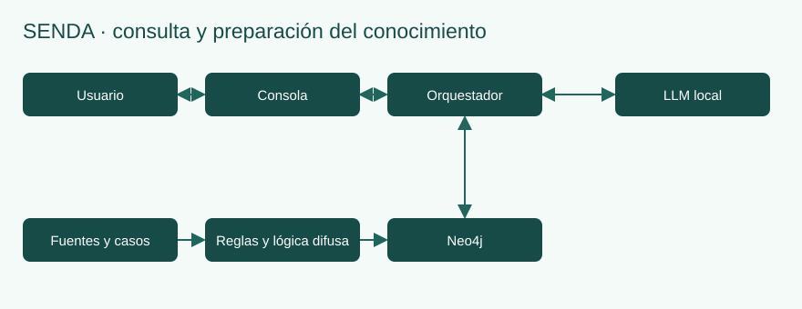

# SENDA — Sistema Experto de Evaluación Nutricional

**Proyecto académico de Inteligencia Artificial**

SENDA integra una **base de conocimiento en Neo4j**, **reglas de inferencia**, **lógica difusa** y un **modelo de lenguaje local (LLM) mediante Ollama** para consultar y explicar evaluaciones nutricionales registradas. Su objetivo es ofrecer respuestas trazables a partir de evidencia presente en el grafo, sin convertir la salida del modelo de lenguaje en una decisión clínica.

> **Importante:** SENDA es un prototipo académico. No diagnostica deficiencias, no prescribe tratamientos ni sustituye la evaluación de profesionales de la salud.

## Contenido

- [¿Qué hace SENDA?](#qué-hace-senda)
- [Arquitectura](#arquitectura)
- [Tecnologías](#tecnologías)
- [Estructura del repositorio](#estructura-del-repositorio)
- [Instalación y configuración](#instalación-y-configuración)
- [Carga de la base de conocimiento](#carga-de-la-base-de-conocimiento)
- [Ejemplos de uso](#ejemplos-de-uso)
- [Pruebas y trazabilidad](#pruebas-y-trazabilidad)
- [Alcance y consideraciones](#alcance-y-consideraciones)

## ¿Qué hace SENDA?

A partir de una consulta en lenguaje natural, el sistema permite:

- Recuperar las evaluaciones de **calcio (CA)**, **hierro (FE)**, **vitamina B12 (B12)** y **vitamina D (VD)**.
- Revisar la **admisibilidad** del caso y consultar uno o varios nutrientes.
- Explicar los estados registrados mediante **reglas, evidencias, advertencias y datos faltantes** del grafo.
- Incorporar **resultados de lógica difusa** como información auxiliar, cuando están disponibles.
- Registrar recorridos para facilitar la **reproducción y auditoría** de las consultas.
- Comprobar el comportamiento con un conjunto de **10 casos de demostración**, identificados desde `P01` hasta `P10`.

Los estados y resultados se obtienen de Neo4j: el LLM interviene para interpretar la consulta y seleccionar fundamentos, **pero no tiene autorización para inventar estados o ejecutar consultas Cypher arbitrarias**.

## Arquitectura



El flujo de consulta es:

1. **Usuario:** formula una pregunta sobre un caso registrado.
2. **Consola y orquestador:** verifican el identificador y los nutrientes solicitados.
3. **LLM local (Ollama):** propone una estructura de consulta en formato JSON.
4. **Validación:** el programa comprueba los datos solicitados y utiliza consultas **Cypher predefinidas**.
5. **Neo4j:** devuelve evaluaciones, trazas de reglas, admisibilidad y resultados auxiliares.
6. **Respuesta:** la consola presenta la información sustentada por los registros recuperados.

La preparación del conocimiento se realiza por separado mediante scripts Cypher que crean los elementos del grafo y ejecutan las reglas de inferencia.

## Tecnologías

| Componente | Tecnología | Uso en el proyecto |
|---|---|---|
| Lenguaje principal | **Python 3.12** | Consola, orquestación, carga y verificaciones |
| Base de conocimiento | **Neo4j Community 5.26** | Grafo de pacientes, hechos, reglas y evaluaciones |
| Lenguaje de consultas | **Cypher** | Construcción y consultas del grafo |
| Modelo de lenguaje | **Ollama + `qwen2.5:1.5b`** | Interpretación local de consultas y selección de fundamentos |
| Dependencias Python | `neo4j==6.4.1`, `jsonschema==4.26.0` | Conexión con Neo4j y validación de estructuras |
| Datos de demostración | **CSV y JSON** | Casos, reglas, conocimiento y resultados de prueba |

Las versiones de Python, Neo4j y del modelo Ollama son las indicadas en el manual incluido en esta entrega.

## Estructura del repositorio

```text
SENDA-IA-Sistema-Experto/
├── base/
│   ├── carga/                      # Archivos CSV: conocimiento y casos
│   ├── scripts/                    # Scripts Cypher de esquema e inferencia
│   │   ├── 00_esquema_y_limpieza.cypher
│   │   ├── 01_ontologia_frames_reglas.cypher
│   │   ├── 02_conocimiento_difuso.cypher
│   │   ├── 03_casos_prueba.cypher
│   │   ├── 04_reglas_e_inferencia.cypher
│   │   └── 05_consultas.cypher
│   └── exportacion_neo4j.json      # Exportación del grafo para inspección
├── implementacion/
│   ├── asistente.py                # Consola para consultas integradas
│   ├── pi4_calcio.py               # Implementación especializada de calcio
│   ├── preparar_demo.py           # Carga inicial de una base vacía
│   ├── consultas/                  # Consultas Cypher parametrizadas
│   ├── prompts/                    # Instrucciones para el LLM
│   ├── requirements.txt
│   └── configuracion.env.ejemplo   # Referencia de variables de entorno
├── pruebas/
│   ├── verificar.py                # Comprobaciones sobre casos seleccionados
│   ├── P01.json ... P09.json       # Recorridos de ejemplo (cinco casos)
│   └── Controles de entrada.txt
├── documentacion/
│   ├── Arquitectura.svg
│   └── Manual.txt
├── .gitignore
└── README.md
```

> Los recorridos JSON incluidos corresponden a `P01`, `P02`, `P03`, `P05` y `P09`; no existe un JSON de prueba para cada caso dentro de esta entrega.

## Instalación y configuración

Los comandos siguientes están preparados para **Windows PowerShell** y se ejecutan desde la **carpeta raíz del proyecto** (donde están `base`, `implementacion` y `pruebas`).

### 1. Requisitos previos

Instalar e iniciar:

- **Python 3.12**.
- **Neo4j Community 5.26**, con una **base de datos vacía exclusiva para la demostración**.
- **Ollama**, con el servicio local en funcionamiento.

### 2. Preparar Python

```powershell
py -3.12 -m venv .venv
.\.venv\Scripts\python.exe -m pip install -r .\implementacion\requirements.txt
```

### 3. Descargar el modelo de Ollama

```powershell
ollama pull qwen2.5:1.5b
ollama list
```

### 4. Configurar las conexiones

En la **misma terminal de PowerShell** desde la que se ejecutará el programa:

```powershell
$env:OLLAMA_MODEL = "qwen2.5:1.5b"
$env:OLLAMA_URL = "http://127.0.0.1:11434"

$env:NEO4J_URI = "bolt://127.0.0.1:7687"
$env:NEO4J_DATABASE = "neo4j"
$env:NEO4J_USER = "neo4j"
$env:NEO4J_PASSWORD = Read-Host "Contraseña de Neo4j" -MaskInput
```

**Atención al puerto:** `7687` es un ejemplo habitual para Neo4j local. La configuración de ejemplo del proyecto usa `17687`. Reemplazá el valor de `NEO4J_URI` por el puerto **Bolt** real de tu instancia.

El archivo [`implementacion/configuracion.env.ejemplo`](implementacion/configuracion.env.ejemplo) documenta las variables disponibles; **los scripts leen variables de entorno y no cargan automáticamente ese archivo**. No publiques contraseñas en el repositorio.

## Carga de la base de conocimiento

Con Neo4j funcionando y una base vacía preparada:

```powershell
.\.venv\Scripts\python.exe .\implementacion\preparar_demo.py --pg2 base
```

El cargador procesa los scripts del `00` al `04` y muestra la cantidad de nodos y relaciones creadas.

**Advertencia de seguridad:** el archivo `base/scripts/00_esquema_y_limpieza.cypher` contiene una instrucción de borrado global. **No ejecutes manualmente ese script sobre una base con información que quieras conservar**. El cargador `preparar_demo.py` comprueba que la base esté vacía y omite la instrucción de borrado. Si se interrumpe la carga, realizá un nuevo intento sobre otra base vacía.

## Ejemplos de uso

### Consulta integrada de varios nutrientes

```powershell
.\.venv\Scripts\python.exe .\implementacion\asistente.py "Compará calcio y hierro de P01"
```

### Revisión integral y registro de recorrido

```powershell
.\.venv\Scripts\python.exe .\implementacion\asistente.py "Revisión integral de P02" --registro recorrido.json
```

La consulta integral utiliza los cuatro nutrientes. El archivo `recorrido.json` guarda la estructura recuperada y la respuesta para su inspección.

### Consulta específica del submódulo de calcio

```powershell
.\.venv\Scripts\python.exe .\implementacion\pi4_calcio.py --consulta "¿Cómo está el calcio de P03?" --compacto
```

El módulo especializado de calcio ofrece controles adicionales de formato, evidencia y redacción. Para usar la consola en modo interactivo, ejecutá el script sin el argumento `--consulta`.

## Pruebas y trazabilidad

Para ejecutar el verificador incluido:

```powershell
.\.venv\Scripts\python.exe .\pruebas\verificar.py
```

El script contrasta los resultados de `P01`, `P02`, `P03`, `P05` y `P09` con `base/carga/casos_resultado_esperado.csv`, comprueba los módulos solicitados y guarda los recorridos JSON en la carpeta `pruebas/`.

**Importante:** esta verificación necesita que Neo4j y Ollama estén funcionando y **sobrescribe los archivos JSON de esos cinco casos**. El repositorio incluye ejemplos de recorridos previos, pero la ejecución local no se ha validado en todos los entornos.

En cada recorrido se pueden inspeccionar, entre otros campos:

- `ruta_llm`: interpretación inicial propuesta por el modelo.
- `ruta_verificada`: resultado de la comprobación contra la solicitud explícita.
- `modulos`: contexto, evidencias y activaciones recuperadas.
- `respuesta`: texto final presentado por la consola.

La exportación `base/exportacion_neo4j.json` sirve para **inspeccionar el grafo**. La reproducción desde cero se realiza con los scripts Cypher mediante el cargador.

## Alcance y consideraciones

- El proyecto se diseñó para **ejecutarse localmente**; no incluye despliegue web ni un servicio de producción.
- Los estados nutricionales provienen de evaluaciones **registradas en el grafo**, no de diagnósticos clínicos realizados por el LLM.
- Los índices y prioridades difusas son **auxiliares y provisionales**; no deben interpretarse como probabilidades clínicas.
- Se recomienda verificar que todos los casos y archivos compartidos estén autorizados para difusión pública antes de publicar el repositorio.

---

